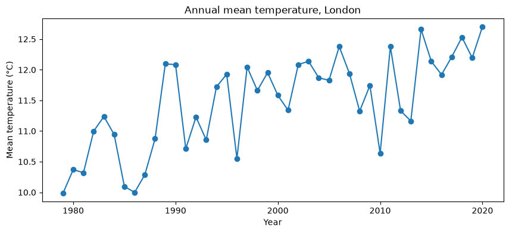

# Predicting mean temperature in London

Compares linear regression, decision trees and random forests for predicting daily mean temperature, with experiments tracked in MLflow.



## Data

`london_weather.csv`: daily weather observations for London, 1979-2020. The data comes from the DataCamp project of the same name.

## Key results

- London's annual mean temperature rose from 10.5 °C (1979-1988) to 12.1 °C (2011-2020).
- Best model: random forest with `max_depth=10`, test RMSE of about 2.8 °C (linear regression: 3.0 °C).
- A single deep decision tree overfits badly (train RMSE 0.8 °C, test 3.8 °C).

## Running the notebook

```bash
pip install -r requirements.txt
jupyter notebook notebook.ipynb
```

Running the notebook creates a local `mlflow.db` file. To browse the runs: `mlflow ui --backend-store-uri sqlite:///mlflow.db`.

## License

The code is released under the [MIT License](LICENSE). Datasets keep the terms of their original sources, described above.
